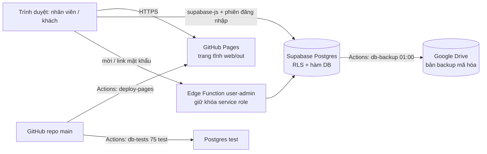
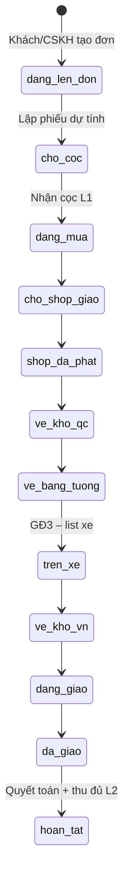
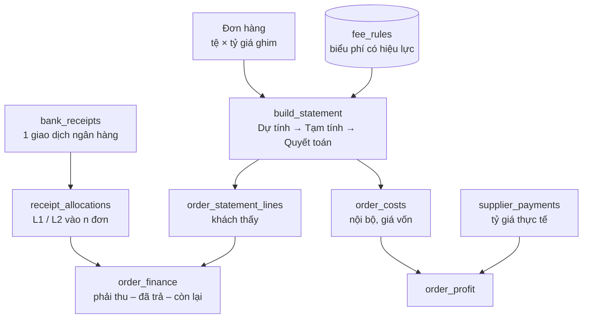

# NAMCHI – Hệ thống hóa quy trình, luồng dữ liệu và chỗ cần sửa

Tài liệu này là "bản đồ" để sau này sửa hệ thống không phải đọc lại toàn bộ code. Bản đồ code tự sinh nằm ở `docs/graph/` (mở `graph.html` bằng trình duyệt; tạo lại bằng `graphify update .`).

## 1. Kiến trúc

- Không có máy chủ ứng dụng: mọi quyền và tính toán tiền nằm trong **database** (RLS + hàm `security definer`), nên trang tĩnh vẫn an toàn.
- Khóa trong trang web là khóa **công khai** (publishable). Khóa bí mật (service role) chỉ tồn tại trong Edge Function.

## 2. Ai thấy gì (RLS)

| Phạm vi | Ai | Hàm quyết định |
| --- | --- | --- |
| Mọi khách | Admin, Quản lý, Kế toán, XNK, Kho | `app.staff_can_see_customer()` + quyền `customer.read_all` |
| Khách được phân công | CSKH | bảng `staff_customer_assignments` còn hiệu lực |
| Một khách | Tài khoản Lanchi cấp tổng | `customer_users.entity_id = null` |
| Một công ty con | Tài khoản Sen Vàng, Thịnh Vượng… | `app.can_see_entity()` |

Giá vốn/lợi nhuận (`order_costs`, `order_profit`) chỉ đọc được với quyền `finance.profit.read` (Admin, Kế toán). Giao dịch tiền cấp Lanchi (`bank_receipts`) công ty con không xem được.

## 3. Luồng đơn hàng (Giai đoạn 2 – đang chạy)

Mọi lần đổi trạng thái tự ghi `order_status_history`. Khách không sửa đơn sau khi gửi (trigger `tg_orders_customer_guard`).

## 4. Luồng tiền

Quy tắc cứng (trong DB, không vượt qua được từ giao diện):

1. Mức phí lấy theo **ngày tạo đơn** → đổi biểu phí không làm sai đơn cũ.
2. Phân bổ tiền **không vượt** số tiền giao dịch, **không chéo khách**, chỉ ghi thêm; sai thì ghi dòng âm (đảo).
3. Dòng phiếu và giá vốn chỉ ghi thêm; lập lại phiếu = bản mới, bản cũ `superseded`.
4. Tiền VND là số nguyên đồng (`bigint`).

Công thức (hàm `public.build_statement`):

| Khoản | Cách tính |
| --- | --- |
| Tiền hàng | `goods_cny × fx_rate` |
| Thuế xuất HĐ TQ | `china_tax_cny × fx_rate` |
| `percent_goods` (mua hàng, TNDN) | `% × tiền hàng` |
| `percent_goods_after_tax` (handle) | `% × (tiền hàng + thuế TQ)` |
| `per_kg` (cước) | `đ/kg × weight_kg` |
| `actual` (kiểm định, ship, thuế NK) | nhập tay ở trang đơn |
| VAT | `vat_rate × cộng` (tạm; GĐ5 lấy theo dòng hóa đơn) |
| Cọc L1 đề xuất | `finance.deposit_rate_percent × tiền hàng` |

## 5. Sửa ở đâu khi cần

| Muốn đổi | Sửa ở |
| --- | --- |
| Mức phí, phí mới theo khách/loại HĐ/nhóm hàng | Màn **Biểu phí** (không cần code) |
| Tỷ lệ cọc, tỷ giá mặc định, hệ số khối | Màn **Cài đặt** |
| Quyền của một vai trò | Màn **Phân quyền** |
| Thêm loại phí có cách tính mới | `fee_types.calc_method` + nhánh trong `build_statement` (migration mới) |
| Thêm trạng thái đơn | check constraint `orders.status` + `web/src/lib/status.ts` |
| Thêm màn hình | `web/src/app/(app)/<ten>/page.tsx` + `web/src/components/nav.ts` |

Quy trình sửa an toàn: tạo migration mới trong `supabase/migrations` → viết test trong `supabase/tests` → `scripts/local/run_tests.sh` xanh → đẩy lên `main` (Pages tự build) → áp migration lên Supabase.

## 6. Lộ trình còn lại

| Giai đoạn | Nội dung | Bảng dự kiến |
| --- | --- | --- |
| 3 | Kho QC/Bằng Tường, kiện & cân đo (D×R×C/6000), dòng khai báo, thư viện HS, list bốc, list xe, snapshot, xuất file khai báo APT | `packages`, `order_items`, `customs_catalog`, `picking_lists`, `trips`, `declaration_snapshots` |
| 4 | Kho VN kiểm đếm 2 tầng, phiếu nhập/xuất, giao nhiều đợt | `vn_receipts`, `goods_issues` |
| 5 | HĐ đầu vào theo Mã HH, HĐ bán L1/L2, tồn HĐ, file MISA, khiếu nại, credit note, xử lý chênh | `purchase_invoices`, `sales_invoices`, `claims`, `credit_notes`, `write_offs` |
